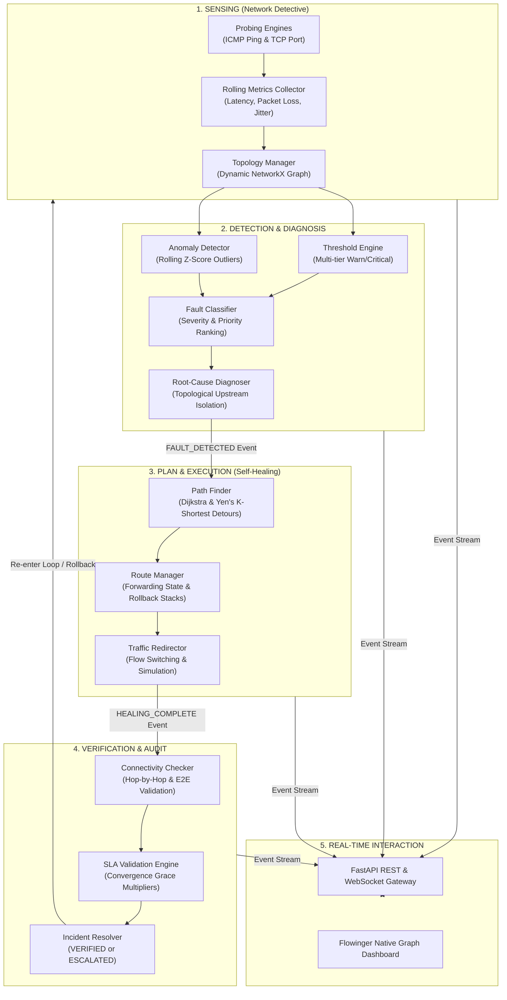
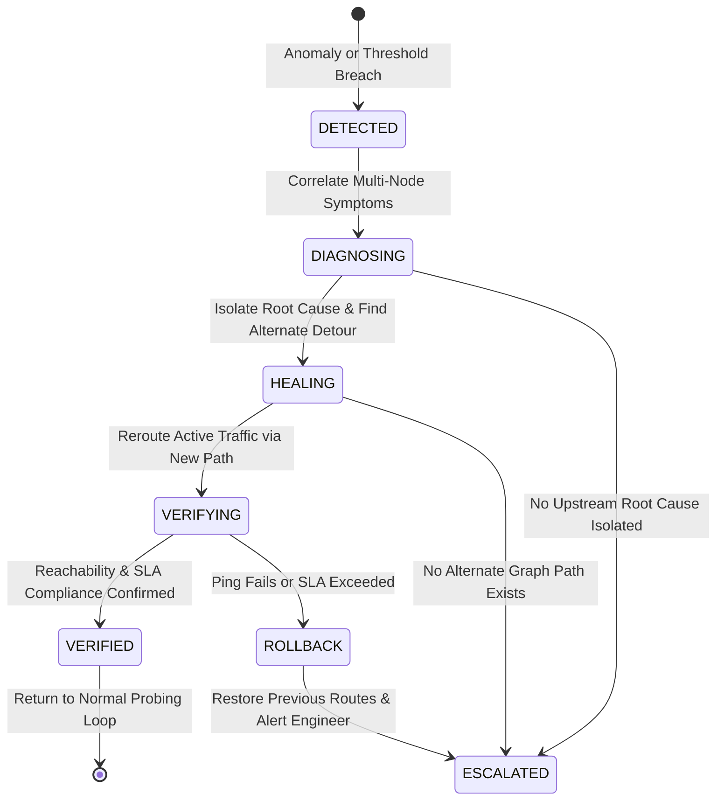

# 🏛️ Architecture & System Design — Network Detective & Self-Healing Network

> **Autonomous Closed-Loop Network Monitoring, Root-Cause Diagnosis, and Dynamic Path Remediation**

---

## 1. High-Level Architectural Model

Network Detective operates on an autonomic closed-loop architecture inspired by IBM's MAPE-K (Monitor, Analyze, Plan, Execute, Knowledge) reference model. It replaces human-in-the-loop manual network administration with continuous, automated self-healing.

---

## 2. Core Subsystems

### 2.1 Network Detective (Monitoring & Telemetry)
- **Probing Engine**: Probes nodes and links using non-blocking multi-sample ICMP ping sequences and concurrent TCP port reachability checks (HTTP, SSH, HTTPS, DNS).
- **Metrics Collector**: Maintains in-memory sliding windows (`deque`) calculating rolling mean, min/max latency, packet loss percentage, and RTT jitter.
- **Topology Manager**: Synchronizes an in-memory weighted graph (`NetworkX`). Edge weights dynamically adjust based on live measured link latency.

### 2.2 Fault Detection & Root-Cause Diagnosis
- **Threshold Engine**: Evaluates telemetry against configured boundaries (`latency_warn_ms`, `latency_critical_ms`, `packet_loss_critical_pct`, `max_retries`).
- **Anomaly Detection**: Computes rolling Z-score statistical deviations ($Z = \frac{x - \mu}{\sigma}$). Detects sudden degrading trends before total link disconnects occur.
- **Fault Classifier**: Merges rule-based violations and statistical anomalies, prioritizing `NODE_DOWN > LINK_DOWN > HIGH_LATENCY > PACKET_LOSS`.
- **Topological Diagnoser**: Performs upstream graph traversal to differentiate root causes from secondary downstream symptom drops.

### 2.3 Self-Healing Engine
- **Dijkstra Detour Computation**: Upon failure confirmation, constructs an isolated subgraph excluding failed components and computes the least-cost alternate path.
- **Yen's K-Shortest Paths**: Computes backup candidate routes in advance to ensure instant failover if the primary alternate path is congested.
- **Route Forwarding State**: The `RouteManager` atomic routing table updates live traffic paths while keeping a rollback stack.

### 2.4 Verification & Incident Resolution
- **Route Stabilization Pause**: Introduces a configurable delay (default 2s) to allow convergence before testing reachability.
- **SLA Validation**: Evaluates hop-by-hop latency and packet loss against operational thresholds with a 1.5x grace multiplier for post-convergence stabilization.
- **Automated Rollback & Escalation**: If verification fails or no alternate path exists, the system automatically rolls back route modifications and marks the incident as `ESCALATED`.

---

## 3. Asynchronous Event Bus

Decoupled inter-module communication is coordinated via `src.core.events.EventBus`:

| Event Topic | Emitter | Consumers | Payload Description |
|-------------|---------|-----------|---------------------|
| `TOPOLOGY_UPDATED` | Monitor / Simulator | WebSocket Gateway, Diagnoser | Graph snapshot with nodes, links, and weights |
| `METRIC_RECORDED` | NetworkMonitor | FaultDetector, WebSocket Gateway | Node ID, latency, packet loss, jitter, timestamp |
| `FAULT_DETECTED` | FaultDetector / FailureInjector | SelfHealer, AlertManager, UI | Incident entity, fault type, affected component |
| `HEALING_STARTED` | SelfHealer | AlertManager, WebSocket UI | Incident entity, affected flows |
| `HEALING_COMPLETE` | SelfHealer | IncidentResolver, WebSocket UI | HealingAction entity, new route, old route, status |
| `VERIFICATION_RESULT` | IncidentResolver | WebSocket UI, AlertManager | Verification verdict, measured metrics, SLA status |

---

## 4. Fault Handling State Machine

