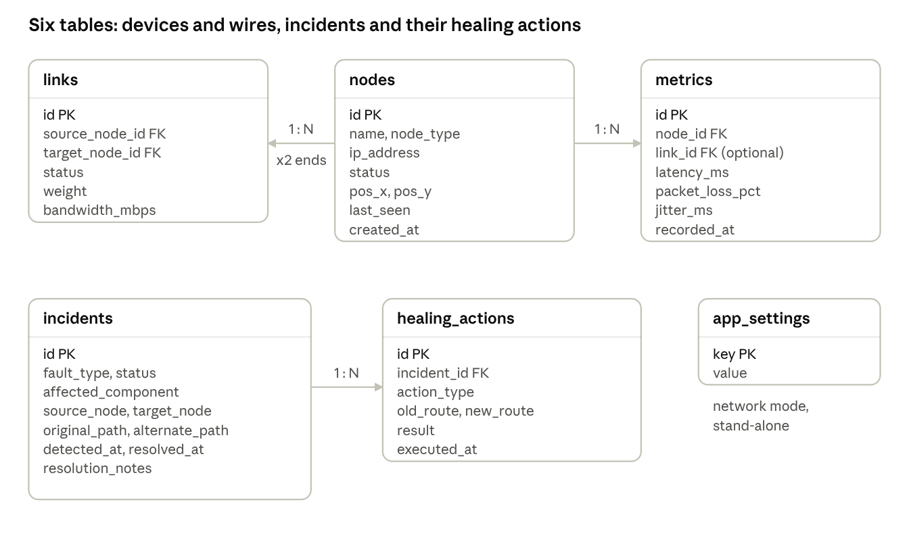
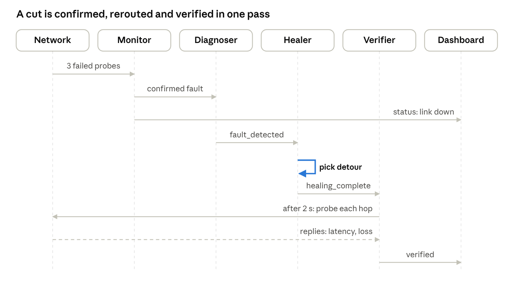
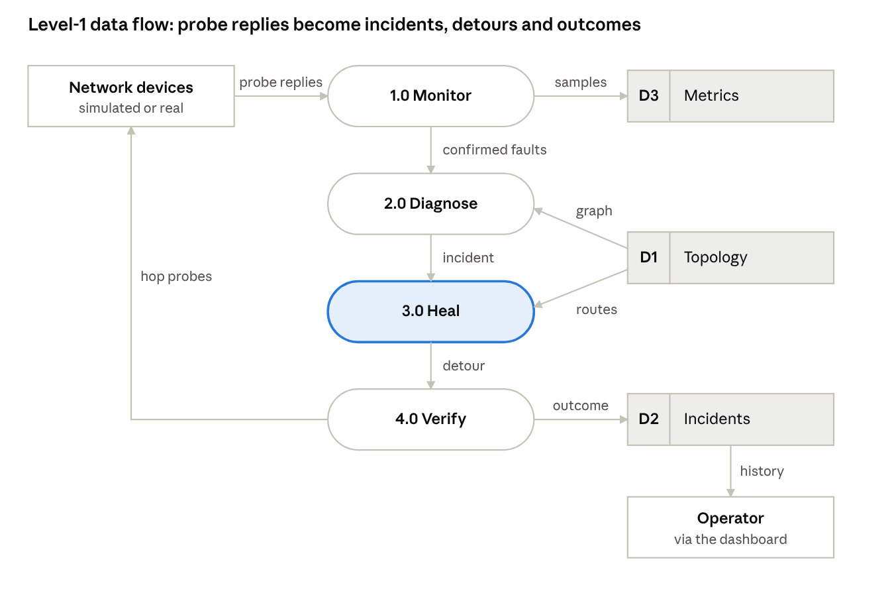
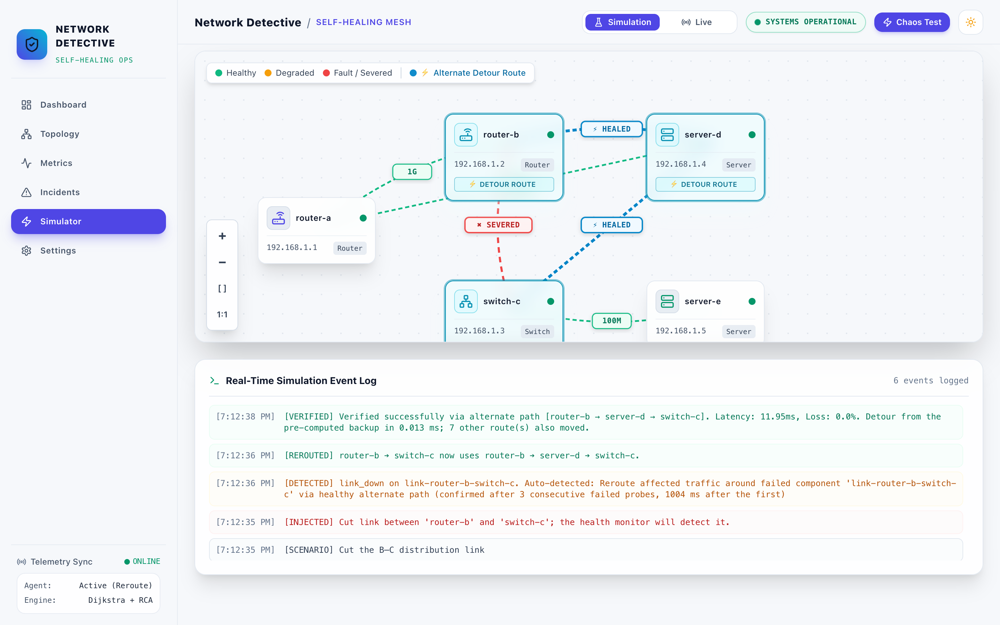
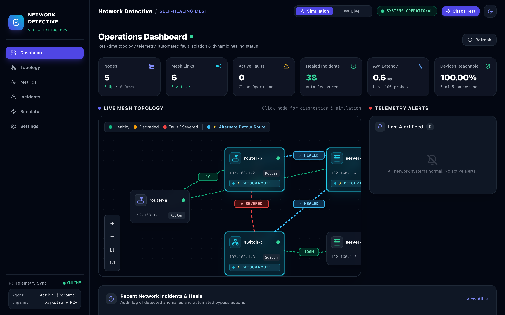

% eyebrow: COMPUTER NETWORKS PROJECT REPORT
% title: Network Detective & Self-Healing Network
% subtitle: Review 2 – Design, Methodology & Implementation Progress
% meta: Course: BCSE308P – Computer Networks · Fall Semester 2026–27
% meta: Assessment 9 component · Status as of 24 October 2026

Network Detective is a working prototype. A health monitor probes every device and link, confirms a failure after 3 consecutive bad probes, finds the root cause, reroutes traffic with a pre-computed backup path (or Dijkstra), and verifies the detour, with no operator involved. It runs in two modes: a built-in **simulation** of a five-device campus network, and **live** mode, which pings real devices such as the Wi-Fi router, this computer and public DNS servers. Devices and wires are added and connected in the web dashboard.

Table: Team members
| Team member | Registration no. |
| --- | --- |
| PV Sai Likith | 24BCI0174 |
| B. Naveen | 24BCE0512 |
| M. Nayan | 24BCE0538 |

---pagebreak---

## 1. System Architecture

The system has three tiers: a React dashboard, a FastAPI server, and a self-healing loop of four subsystems that probe either a simulated network or real devices and store everything in SQLite.


The four loop stages run in order for every fault and never call each other directly. The monitor's events start the diagnoser, the healer's events start the verifier, and every event is also pushed to the dashboard over the WebSocket.

## 2. Detailed Design

The backend is split into six subsystems that never call each other directly. They hand work to each other as events on a shared in-memory event bus, so each one can be replaced or tested alone. The database is the single source of truth for the topology.

Table: Subsystems and their responsibilities
| Subsystem | Package | Responsibility | Key classes |
| --- | --- | --- | --- |
| Monitor | `src/monitor` | Probe every device and link on a fixed interval, confirm failures, store telemetry, keep the topology in step with the database | HealthMonitor, LiveProber, TopologyService, MetricsCollector, TopologyBuilder |
| Detector | `src/detector` | Threshold and statistical checks, fault ranking, graph-based root cause, incident creation and deduplication | ThresholdEngine, AnomalyDetector, FaultClassifier, Diagnoser, AlertManager |
| Healer | `src/healer` | Pre-compute backup routes; on a fault, pick a detour that avoids every failed part and apply it | RouteManager, PathFinder, TrafficRedirector, SelfHealer |
| Verifier | `src/verifier` | Probe every hop of the detour, check it against the limits, then resolve, roll back or escalate | ConnectivityChecker, ValidationEngine, IncidentResolver |
| Simulation | `src/simulation` | In-memory network whose link delay comes from weight and bandwidth; inject and repair faults | VirtualNetwork, FailureInjector |
| API | `src/api` | REST endpoints, WebSocket push, request validation | FastAPI routers, Pydantic schemas |

**Two network modes.** In *simulation* mode the monitor reads the VirtualNetwork. In *live* mode LiveProber sends one real ICMP echo to every device in parallel, and the verifier pings each hop of a detour. Wires stay logical in both modes, because a ping cannot test one cable on its own.

**Event topics.** Every hand-off between subsystems is one of these events.

Table: Events on the internal event bus
| Event | Published by | Consumed by | Payload |
| --- | --- | --- | --- |
| `fault_detected` | AlertManager | SelfHealer, WebSocket | Incident: component, fault type, affected flow |
| `healing_started` | SelfHealer | WebSocket | Incident id, component |
| `healing_complete` | SelfHealer | IncidentResolver, WebSocket | Incident, healing action, old and new path, how the detour was found |
| `verification_result` | IncidentResolver | WebSocket | Success flag, measured latency and loss |
| `metric_recorded` | HealthMonitor | WebSocket | Device, latency (ms), loss (%), jitter (ms) |
| `topology_updated` | HealthMonitor, TopologyService | WebSocket, dashboard | Device and wire status snapshot |

**REST API.** FastAPI serves these endpoints; interactive documentation is at `http://localhost:8000/docs`.

Table: REST and WebSocket endpoints
| Method and path | Purpose |
| --- | --- |
| `GET /api/topology` | Devices, wires, status and canvas positions |
| `POST /api/topology/nodes`, `PATCH`/`DELETE /api/topology/nodes/{id}` | Add, edit, move or remove a router, switch or server |
| `POST /api/topology/links`, `DELETE /api/topology/links/{id}` | Connect two devices with a wire, or remove it |
| `GET`/`PUT /api/network/mode` | Read or switch between simulation and live |
| `POST /api/network/ping`, `GET /api/network/suggestions` | Test-ping an address; suggest real devices (gateway, this computer, public DNS) |
| `GET /api/incidents`, `/active`, `/{id}` | Incident history with healing actions |
| `GET /api/metrics/node/{id}?minutes=` | Stored probe samples for a time window |
| `POST /api/simulator/failure`, `/recover`, `/reset` | Break or repair a device or wire; reset everything |
| `GET`/`PUT /api/config` | Thresholds, probe interval, healing and rollback switches (applied at once) |
| `WS /ws/live` | Push events to the dashboard |

**Defaults.** From `config/default.yaml`: latency warning 100 ms, critical 200 ms; packet loss warning 5 %, critical 10 %; 3 consecutive failed probes to confirm; probe every 0.5 s (simulation) or 1 s (live); wait 2 s before verifying a detour.

## 3. Methodology / Algorithm

The system runs a closed loop: probe, confirm, diagnose, reroute, verify, then resolve or escalate, and fail back when the part is repaired. Each step is its own class, started by the event the step before it publishes.

**Step 1 – Probe and confirm (HealthMonitor).** Every cycle (0.5 s in simulation, 1 s in live mode) the monitor probes every device and every link.

1. A device is *bad* when it does not answer, or when ThresholdEngine rates its sample critical: latency ≥ 200 ms or loss ≥ 10 %.
2. A link is *bad* when it is cut, or when either end does not answer (as with a real ping across it).
3. A failure counts only after **3 consecutive bad samples**, so one lost packet never triggers healing.

A statistical check (AnomalyDetector, rolling 30-sample z-score ≥ 2.5) is implemented and unit-tested for the threshold-free path; the running loop uses thresholds plus confirmation.

```formula
z = | x − μ₃₀ | / σ₃₀  ≥  2.5
```

**Step 2 – Root cause (Diagnoser).** The failures confirmed in one cycle are diagnosed together on the topology graph. A crashed device explains the failures of every wire attached to it, so it raises one incident, not one per wire. Faults are ranked: device down, link down, high latency, packet loss. AlertManager stores the incident and ignores duplicates while the part stays down.

**Step 3 – Reroute (fast reroute with Dijkstra fallback).** Whenever the topology changes, RouteManager computes every shortest route, and for each route and each link or transit device on it, the best detour that avoids that part. On a fault, SelfHealer uses that stored detour if it avoids every failed part; otherwise it runs Dijkstra on the graph without the failed parts:

```formula
P* = argmin over paths P from s to t with P ∩ F = ∅  of  Σ (u,v)∈P  w(u,v)
```

F is every failed link and device, w is the configured link weight. Traffic to or from a crashed device cannot be saved, so for a device failure the healer reroutes the flows that pass *through* it. All other affected routes move too.

**Step 4 – Verify (IncidentResolver).** After 2 s for routes to settle, every hop and link of the detour is probed: from the simulation model, or with real pings in live mode. ValidationEngine accepts the detour when latency ≤ 300 ms and loss ≤ 15 % (the critical limits × 1.5 for convergence).

**Step 5 – Resolve, escalate, fail back.** A passing detour marks the incident *verified*. A failing one is rolled back and *escalated*. With no detour at all the incident is escalated at once, naming what the failure cut off (for example “Link switch-c–server-e was the only connection to server-e”). When the monitor sees the part answer again, it restores its status, recomputes the routes (failback) and closes the incident.

```code
every cycle:
    bad <- devices/links that fail a probe or a critical threshold
    streak[c] <- streak[c] + 1 if c in bad else 0
    new <- {c : streak[c] >= 3 and c not already reported}
    while new:
        root <- Diagnoser(new)                 # a device explains its own wires
        mark root (and its wires) down; raise incident  -> FAULT_DETECTED
        remove explained faults from new
    for each reported root that answers again: mark up, rebuild routes, close incident

on FAULT_DETECTED(incident):
    F <- failed component + everything already down
    path <- backup[flow, component] if it avoids F else Dijkstra(graph - F, flow)
    if path is None: escalate(reason = what F cuts off)
    else: apply path to every affected flow; publish HEALING_COMPLETE

on HEALING_COMPLETE(incident, path):
    sleep(2 s); probe every hop of path
    if reachable and latency <= 300 ms and loss <= 15 %: VERIFIED
    else: roll back; ESCALATED
```

## 4. Database / UML / DFD

**Database (ER diagram).** Six tables in SQLite through SQLAlchemy 2.0. The topology lives in `nodes` and `links`, so it survives restarts and is edited from the dashboard. Every incident keeps its healing actions.



An incident names its failed component in `affected_component` (a device or a wire), so it keeps its history after that device is removed. Columns added in later versions (for example the canvas position) are added to an existing database automatically at startup.

**Fault-to-recovery sequence (UML).** The path of one link cut through the system, from the first failed probe to the verified detour.



The monitor needs 3 failed probes (about 1.2 s in simulation) before it reports anything. The healer's choice is a table lookup in 0.01–0.02 ms, and the verifier waits 2 s before probing the detour.

**Level-1 data flow (DFD).** The four processes, the three stores they read and write, and the two external entities.



The operator also writes to D1 when adding, wiring or removing devices, and 2.0 Diagnose writes each new incident into D2.

## 5. Module Development

The backend is 9,214 lines of Python in 38 source files, the dashboard is 5,890 lines of TypeScript/React, and the tests are 1,418 lines. The code is under Git with three feature commits on top of the baseline.

Table: Modules developed
| Module | Main source files | Lines | What was built |
| --- | --- | --- | --- |
| Monitor | health_monitor.py, live_probe.py, topology_service.py, metrics_collector.py, topology_builder.py, ping_probe.py, tcp_probe.py | 1,870 | Probe loop with 3-sample confirmation, real ICMP probing, add/remove devices and wires, telemetry storage with jitter |
| Detector | threshold_engine.py, anomaly_detector.py, fault_classifier.py, diagnoser.py, alert_manager.py, fault_detector.py | 1,271 | Threshold and z-score checks, fault ranking, graph root cause, incident deduplication |
| Healer | route_manager.py, path_finder.py, self_healer.py, traffic_redirector.py | 1,386 | Routing table, pre-computed backup routes, Dijkstra fallback, reroute, rollback, escalation reasons |
| Verifier | connectivity_checker.py, validation_engine.py, incident_resolver.py | 695 | Hop-by-hop path probing (model or real ping), limits check, resolve / roll back / escalate |
| Simulation | virtual_network.py, failure_injector.py | 798 | Link delay from weight and bandwidth with ±5 % jitter; fault injection and repair |
| Core | config.py, events.py, models.py | 838 | Settings (environment over YAML), event bus, SQLAlchemy models with automatic column migration |
| API | routes/*.py, schemas.py, websocket.py, main.py | 2,106 | REST and WebSocket endpoints, startup wiring of the whole loop |
| Utilities | helpers.py, logger.py | 250 | Ping/TCP helpers, logging |
| Dashboard | 6 pages, 11 components, 4 hooks | 5,890 | Topology editor, live/simulation switch, light/dark theme, incidents, metrics, simulator, settings |

## 6. Working Prototype

The prototype runs on one laptop: a FastAPI backend on port 8000 and the React dashboard on port 3000. All screenshots below are taken from the running system in light mode.

```code
.venv/bin/uvicorn src.main:app --port 8000      # backend: monitor, healer, verifier, API
cd frontend && npm run dev                       # dashboard on http://localhost:3000
```

**Dashboard after a link cut.** Link router-b–switch-c was cut. The monitor confirmed it, traffic moved to router-b → server-d → switch-c (highlighted as the detour), and the cards show live counts.


**Topology editor.** Devices are added, wired, dragged and edited here. Clicking a device opens its stored measurements and an edit form.


**Adding a real device.** The dialog suggests devices reachable from this computer and can ping an address before adding it. Here the home router replied in 6.4 ms.


**Simulator log.** Breaking a wire from the Simulator page logs each real stage as the backend reports it: detection after 3 failed probes, the reroute, and verification with the measured latency.



**Live mode on real devices.** The same system monitoring the laptop, the Wi-Fi router, Google DNS and Cloudflare DNS, plus an address with no device behind it, which is detected as offline.


The header switches between Simulation and Live, and between light and dark themes (an animated circular reveal).



## 7. Implementation Progress

Every phase of the Review 1 plan through integration and testing is complete; documentation for Review 3 is in progress. Status as of 24 Oct 2026.

Table: Progress against the Review 1 timeline
| Review 1 phase | What was delivered | Status |
| --- | --- | --- |
| Requirements and literature survey (weeks 1–2) | Problem statement, objectives, survey (Review 1, 11 Sep 2026) | Done |
| System design (weeks 3–4) | Event-driven architecture of six subsystems; database as single source of truth | Done |
| Monitoring module (weeks 5–6) | Probe loop with 3-sample confirmation; simulated and real ICMP probing; telemetry with jitter | Done |
| Fault detection and diagnosis (weeks 7–8) | Threshold and z-score checks, fault ranking, graph root cause, one incident per root cause | Done |
| Path finding and self-healing (weeks 9–10) | Dijkstra, pre-computed backup routes, reroute of all affected flows, rollback, escalation reasons, failback | Done |
| Integration and testing (week 11) | Whole loop wired into the server; 48 automated tests incl. 9 end-to-end | Done |
| Verification, documentation, presentation (week 12) | Review 2 and Review 3 documents, slides, live demo | In progress |
| Beyond the plan | Topology editor (add/wire/remove devices), live mode on real devices, light/dark theme, honest dashboard data | Done |
| Scaling the backup-route table | Incremental re-computation for networks above about 50 devices | Planned |

## 8. Test Cases

All 48 automated tests pass (pytest, 10.3 s). The end-to-end tests start the real server against a throw-away database and drive it over HTTP, so detection, healing and verification run exactly as in the demo.

Table: Automated test suite
| Area | Test file | Tests | What is checked |
| --- | --- | --- | --- |
| End to end | test_api_e2e.py | 9 | Full loop over HTTP (cases TC-01 to TC-09 below) |
| Monitor | test_monitor.py | 8 | Ping and TCP probes, metric windows, topology graph, polling |
| Detector | test_detector.py | 6 | Thresholds, z-score anomalies, fault ranking, root cause, incident deduplication |
| Healer | test_healer.py | 6 | Shortest and k-shortest paths with exclusions, routing table, redirect, healing events |
| Event bus | test_events.py | 4 | Publish/subscribe, wildcard, unsubscribe |
| Helpers | test_helpers.py | 4 | Timestamps, path formatting, TCP checks |
| Config and models | test_config.py, test_models.py | 4 | YAML and environment settings, ORM create/read |
| Simulation | test_simulation.py | 3 | Virtual network lifecycle, degradation, failure injector |
| Verifier | test_verifier.py | 3 | Limit checks, path probing, resolve / roll back |
| Logging | test_logger.py | 1 | Logger setup |

Table: End-to-end test cases
| ID | Scenario | Input | Expected | Actual | Result |
| --- | --- | --- | --- | --- | --- |
| TC-01 | Link cut is healed | Cut router-b–switch-c | Detected, rerouted via server-d using the stored backup, verified | As expected | Pass |
| TC-02 | Repair fails back | Repair the same link | Link up, routes back on primary, incident notes the recovery | As expected | Pass |
| TC-03 | Transit router crash | Crash router-b | Detour avoids router-b, verified | router-a → server-d → switch-c | Pass |
| TC-04 | Failure that isolates a device | Cut switch-c–server-e | Escalated, reason names server-e; reset closes it but keeps “escalated” | As expected | Pass |
| TC-05 | Second failure | Cut switch-c–server-d, then router-b–switch-c | Second detour may not reuse the first broken link; escalated | As expected | Pass |
| TC-06 | Edit the topology | Add a switch, wire it, move it, remove it | 201 on create, 409 on a duplicate wire, position saved, wires removed with the device | As expected | Pass |
| TC-07 | Bad input | Invalid IP, duplicate IP, unknown device, self-loop wire | 400 / 409 / 404 / 400 | As expected | Pass |
| TC-08 | Live mode | Switch to live; ping 127.0.0.1 | Real ping succeeds; unreachable 192.168.1.x devices detected; device crash refused (409) | As expected | Pass |
| TC-09 | Healing switched off | Turn healing off, cut a link | Detected and escalated, nothing rerouted | As expected | Pass |

## 9. Initial Results

Every one of the 11 possible single failures in the campus network was handled correctly in all 5 runs. All 6 failures that left a detour were healed and verified, and all 5 that cut a device off were escalated with the right reason. A failure was confirmed about 1.2 s after it happened, and a decision followed 6–12 ms later.

Table: All single failures in the simulated campus network (5 runs each)
| Failure | Outcome (5/5 runs) | Detour | Detected after (s) | Decision after (ms) | Path latency before → after (ms) |
| --- | --- | --- | --- | --- | --- |
| Link router-a–router-b | Verified | router-a → server-d → router-b | 1.24 | 11.9 | 3.2 → 18.2 |
| Link router-b–switch-c | Verified | router-b → server-d → switch-c | 1.23 | 11.4 | 5.3 → 12.0 |
| Link router-b–server-d | Verified | router-b → switch-c → server-d | 1.23 | 9.5 | 7.3 → 10.1 |
| Link switch-c–server-d | Verified | switch-c → router-b → server-d | 1.19 | 11.8 | 5.3 → 12.1 |
| Link router-a–server-d (backup link) | Verified, routes unchanged | none needed: no route used it | 1.21 | 8.4 | 9.9 → 9.9 |
| Device router-b | Verified | router-a → server-d → switch-c | 1.24 | 10.5 | 7.9 → 16.1 |
| Link switch-c–server-e | Escalated: only connection to server-e | – | 1.23 | 7.0 | – |
| Device switch-c | Escalated: cuts off server-e | – | 1.23 | 8.0 | – |
| Device router-a | Escalated: no transit traffic | – | 1.24 | 5.8 | – |
| Device server-d | Escalated: no transit traffic | – | 1.21 | 8.2 | – |
| Device server-e | Escalated: end device | – | 1.25 | 6.9 | – |

“Detected after” runs from the moment of the cut to the incident: 3 probes at 0.5 s intervals. “Decision after” runs from the incident to the reroute or escalation. Every detour came from the pre-computed backup table. “Before” is the primary path's latency in the model; “after” is the mean latency measured by the verifier. Each incident was verified about 3.25 s after the cut, because the verifier waits 2 s for routes to settle.

In **live mode** on the real home network, an unreachable address was reported 6.2–6.5 s after it was added. A cut wire between the router and Google DNS was detected in 4.4–4.5 s and rerouted through Cloudflare DNS. The detour was verified with real pings (48–112 ms) in 5 of 5 runs.

## 10. Individual Contribution

Each member owned the modules assigned in Review 1; all three shared the architecture, integration testing and these documents.

Table: Individual contribution
| Member | Reg. no. | Modules owned | Work done |
| --- | --- | --- | --- |
| PV Sai Likith | 24BCI0174 | Monitor (src/monitor) | Probe loop with 3-sample confirmation; real ICMP probing for live mode; telemetry storage with jitter; topology service for adding, wiring and removing devices; live-mode demo on the home network |
| B. Naveen | 24BCE0512 | Detector and path finding (src/detector, path_finder.py, route_manager.py) | Threshold and z-score checks; fault ranking; graph root cause that groups a device with its wires; Dijkstra and k-shortest paths; pre-computed backup routes and their benchmarks |
| M. Nayan | 24BCE0538 | Healer, verifier, integration (self_healer.py, src/verifier, tests, dashboard) | Reroute of all affected flows, rollback and escalation reasons; detour verification and failback; end-to-end tests; dashboard pages and documentation |
