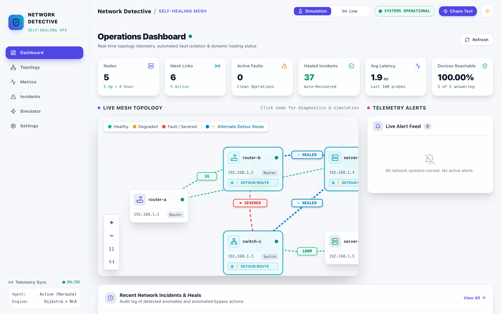
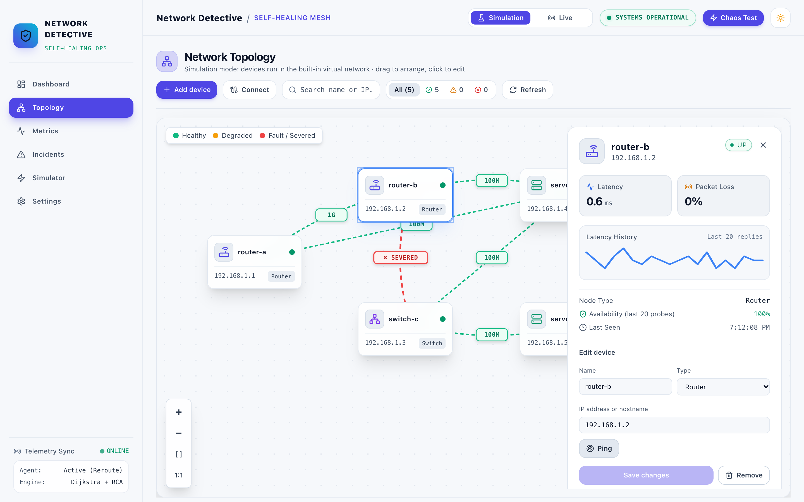
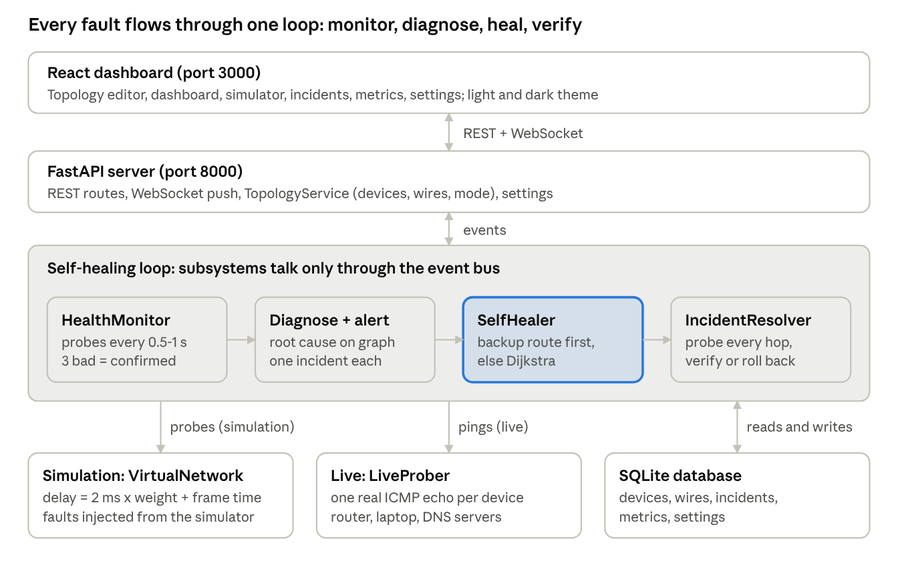
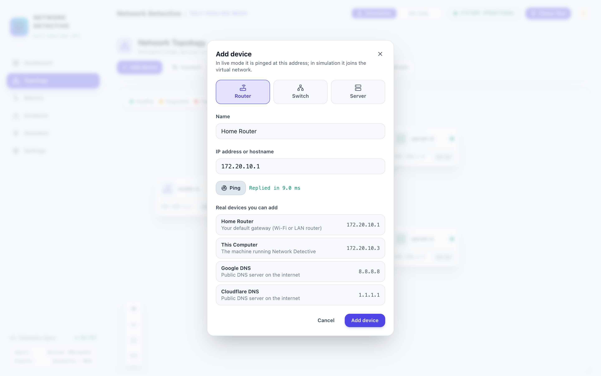
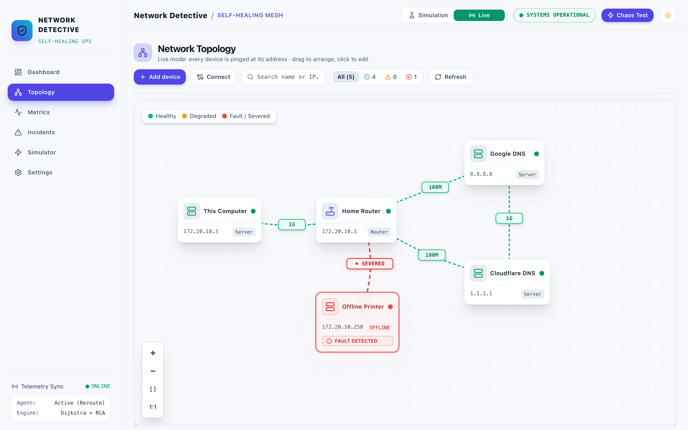
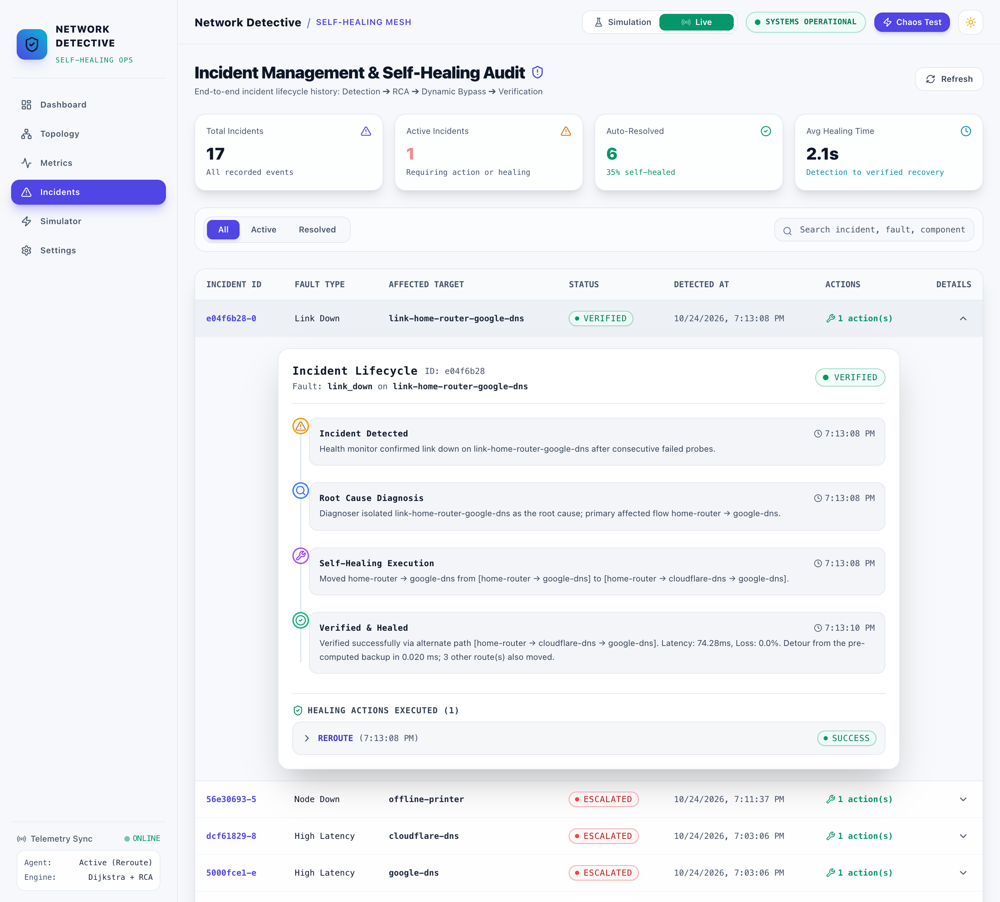
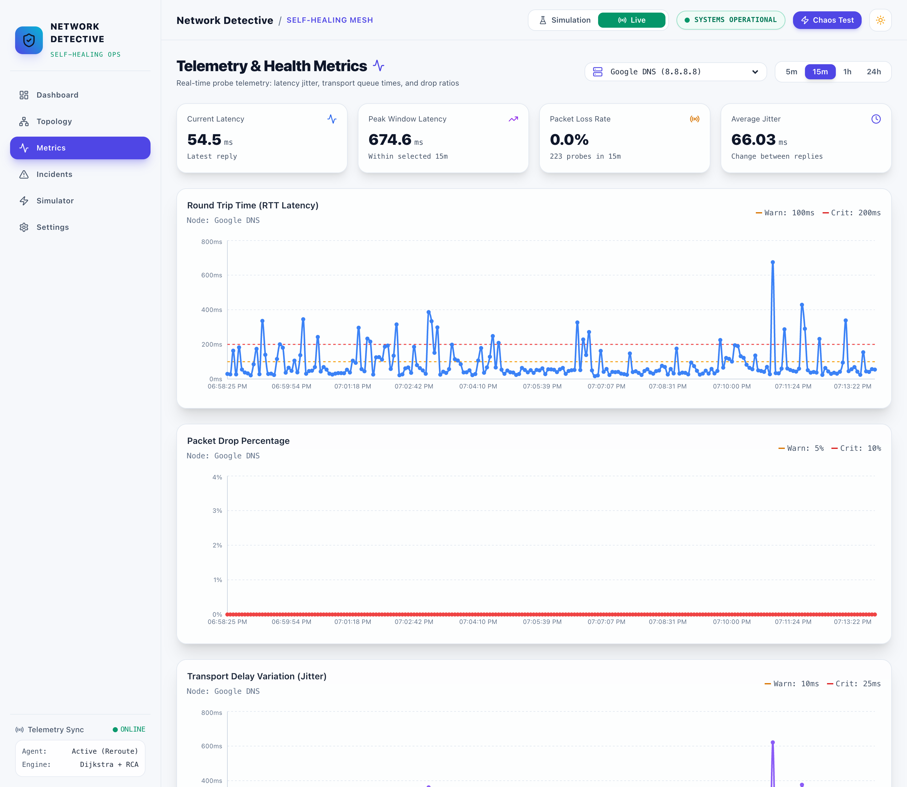
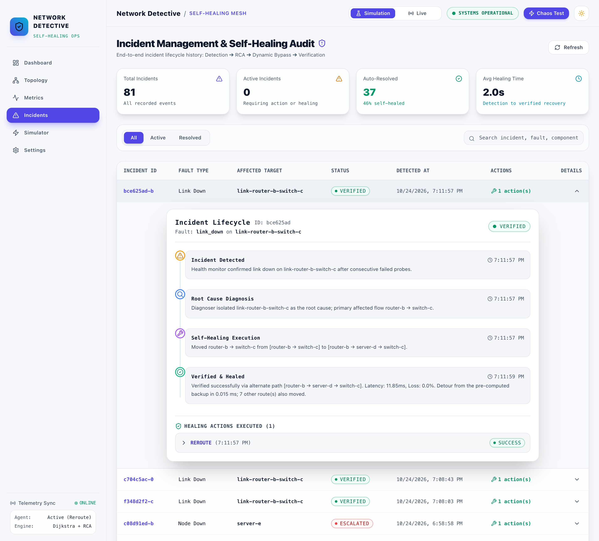
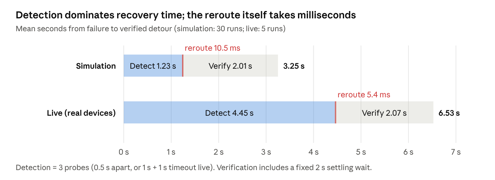
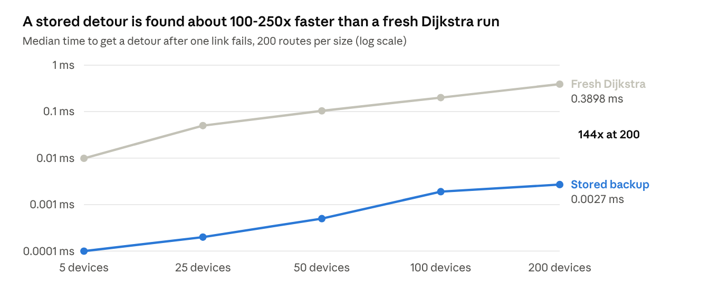

% eyebrow: COMPUTER NETWORKS PROJECT REPORT
% title: Network Detective & Self-Healing Network
% subtitle: Review 3 – Final Project: Implementation, Results & Outcome
% meta: Course: BCSE308P – Computer Networks · Fall Semester 2026–27
% meta: Assessment 10 component · 24 October 2026

Network Detective is complete. It detects a broken link or device in about 1.2 s (simulation) or 4–7 s (live, on real devices). It reroutes traffic within milliseconds of detection, verifies the detour, and escalates only the failures that no detour can fix. It works on a simulated campus network and on real devices pinged over the network, and all 48 automated tests pass.

Table: Team members
| Team member | Registration no. |
| --- | --- |
| PV Sai Likith | 24BCI0174 |
| B. Naveen | 24BCE0512 |
| M. Nayan | 24BCE0538 |

---pagebreak---

## 1. Complete Working Project

The finished system closes the whole loop from Review 1 (monitor, detect, diagnose, find a path, self-heal, verify) and adds two things the plan did not have: a topology editor and a live mode on real devices.

Table: Capabilities of the finished system
| Capability | How it works in the finished system |
| --- | --- |
| Monitoring | Every device and wire is probed every 0.5 s (simulation) or 1 s (live); telemetry is stored with latency, loss and jitter |
| Detection | A failure counts after 3 consecutive bad probes; latency ≥ 200 ms or loss ≥ 10 % counts as a fault too |
| Diagnosis | Faults found in the same cycle are diagnosed together; a crashed device is reported once, not once per wire |
| Path finding | A pre-computed backup detour is used if it avoids every failed part; otherwise Dijkstra runs on the remaining graph |
| Self-healing | Every affected route moves to its detour; traffic through a crashed device is routed around it |
| Verification | After 2 s every hop of the detour is probed; it passes at ≤ 300 ms and ≤ 15 % loss, or is rolled back |
| Escalation | Failures with no detour go to an engineer with the reason (for example, which device is now cut off) |
| Failback | When the part answers again, routes return to the primary paths and the incident is closed |
| Topology editor | Add routers, switches and servers with an IP address, connect them with wires, drag, edit, remove |
| Two modes | Simulation (built-in virtual network) or live (real ICMP pings to each device's address) |
| Settings | Thresholds, probe interval, and switches for self-healing and rollback, applied without a restart |





## 2. Final System Architecture

The final system has three tiers. The four stages of the healing loop exchange events only, and the same loop runs over a simulated network or real devices.



Compared with the Review 1 workflow, the final design adds a confirmation step before any fault is acted on, a pre-computed backup table in front of Dijkstra, and failback after repair. The database became the single source of truth for the topology, so the network is edited from the dashboard instead of a config file.

## 3. Complete Implementation

The implementation is 9,214 lines of Python in 38 modules, a 5,890-line React dashboard, and 1,418 lines of tests, kept in Git.

Table: Technologies used
| Layer | Technology | Used for |
| --- | --- | --- |
| Backend | Python 3.14, FastAPI, Uvicorn | REST and WebSocket API, startup wiring of the healing loop |
| Graph algorithms | NetworkX | Topology graph, Dijkstra, k-shortest paths, connected components for escalation reasons |
| Real probing | ping3 (ICMP echo), TCP connect | Live-mode reachability and round-trip time |
| Storage | SQLAlchemy 2.0 (async) + SQLite | Devices, wires, incidents, healing actions, metrics, settings |
| Validation and config | Pydantic v2, pydantic-settings, YAML | Request checks; settings from environment over YAML |
| Dashboard | React 18, TypeScript, Vite, Tailwind CSS, Recharts | Editor, charts, light/dark theme with an animated switch |
| Testing | pytest, FastAPI TestClient | 48 tests: unit and end-to-end over HTTP |

Table: Code size by package
| Package | Lines | Main classes |
| --- | --- | --- |
| src/monitor | 1,870 | HealthMonitor, LiveProber, TopologyService, MetricsCollector |
| src/api + main.py | 2,106 | Routers for topology, network mode, simulator, incidents, metrics, config |
| src/healer | 1,386 | RouteManager (backup table), SelfHealer, PathFinder, TrafficRedirector |
| src/detector | 1,271 | ThresholdEngine, AnomalyDetector, Diagnoser, AlertManager |
| src/core | 838 | Settings, event bus, database models |
| src/simulation | 798 | VirtualNetwork, FailureInjector |
| src/verifier | 695 | IncidentResolver, ConnectivityChecker, ValidationEngine |
| src/utils | 250 | Helpers, logging |

**Running it.**

```code
python3 -m venv .venv && .venv/bin/pip install -e ".[dev]"
.venv/bin/uvicorn src.main:app --port 8000
cd frontend && npm install && npm run dev        # http://localhost:3000
.venv/bin/pytest                                  # 48 tests
```

## 4. Live Demonstration

The demo runs in about 6 minutes: first the simulated campus network, then the same software on real devices on the hotspot network.

1. **Simulation – link cut.** On the Simulator page, press *Fiber Cut*. The log shows the cut confirmed after 3 probes, rerouted through server-d, and verified at about 12 ms.
2. **Simulation – router crash.** Press *Core-B Fail*. Traffic from router-a to switch-c moves to router-a → server-d → switch-c.
3. **Simulation – no detour.** Press *Switch-C Crash*. The incident is escalated: “switch-c is down and cuts off server-e”.
4. **Repair and failback.** Click the cut wire on the Topology page and press *Repair wire*. Routes return to the primary path and the incident notes the recovery.
5. **Build a real network.** Switch to *Live*. With *Add device*, add the suggested home router, this computer, Google DNS and Cloudflare DNS (each test-pinged first), plus one unused address as an offline device. Wire them with *Connect*.
6. **Real detection.** The unused address is flagged within about 6.5 s, and the dashboard shows real latency.
7. **Real healing.** Cut the router–Google DNS wire. Within about 4.5 s traffic moves through Cloudflare DNS, and the detour is verified with real pings.
8. **Comparison.** In Settings, turn self-healing off and repeat step 7. The fault is still detected but only escalated, which is what a conventional monitoring tool would do.









## 5. Test Results

All 48 automated tests pass. Every scenario run against the running system (55 simulated, 10 live) ended with the correct outcome: verified when a detour existed, escalated with the right reason when none did.

Table: Test results
| Test set | Runs | Passed | What it covers |
| --- | --- | --- | --- |
| Unit tests (10 files) | 39 | 39 | Probes, thresholds, z-score, root cause, path finding, routing table, event bus, verifier, config, models |
| End-to-end tests over HTTP | 9 | 9 | Link cut, failback, router crash, isolation, double fault, topology editing, bad input, live mode, healing switched off |
| Simulated single failures (11 kinds × 5) | 55 | 55 | 30 healed and verified, 25 correctly escalated; same result in every run |
| Live: unreachable device detected | 5 | 5 | Address with no device behind it reported as down |
| Live: wire cut between real devices | 5 | 5 | Router–Google DNS cut, rerouted via Cloudflare DNS, verified with real pings |

Bugs found and fixed while testing, each now covered by a test:

- Link IDs such as `link-b-c` from the dashboard were split on the first hyphen and rejected.
- Closing an escalated incident marked it “verified”, which inflated the self-healed count.
- A second failure could be routed through the first broken link.
- Tests wrote demo incidents into the real database, because YAML settings overrode environment variables.
- Times were sent without a timezone, so the dashboard showed UTC as local time.



## 6. Performance Analysis

A failure is fixed in 3.25 s in simulation and 6.53 s live, measured from the moment of failure to a verified detour. Almost all of that is the 3-probe confirmation and the fixed 2 s settling wait: choosing and applying the detour takes 5–11 ms.



**Fast reroute.** Looking up a stored detour stays near a microsecond as the network grows, while a fresh Dijkstra run grows with the network.



The price is the table itself. It holds a detour for every route and every link or device on it, so building it grows roughly with the cube of the network size. That is fine for campus networks; above about 50 devices it needs the incremental update listed under future work.

Table: Cost of building the backup-route table
| Devices | Routes | Detours stored | Time to build the table |
| --- | --- | --- | --- |
| 5 | 20 | 44 | 1 ms |
| 25 | 600 | 3,020 | 0.34 s |
| 50 | 2,450 | 15,910 | 3.7 s |
| 100 | 9,900 | 83,670 | 39 s |
| 200 | 39,800 | 395,332 | 370 s |

**Real network measurements (live mode).** Each device was pinged once a second for about 20 minutes over a phone hotspot (615 samples per device).

Table: Real round-trip times measured in live mode
| Device | Address | Median RTT (ms) | 95th percentile (ms) | Max (ms) | Samples above 200 ms | Loss |
| --- | --- | --- | --- | --- | --- | --- |
| This computer | 172.20.10.3 | 0.5 | 1.2 | 7.3 | 0 % | 0 % |
| Home router (hotspot) | 172.20.10.1 | 5.9 | 11.3 | 89.2 | 0 % | 0 % |
| Google DNS | 8.8.8.8 | 44.5 | 248.2 | 795.4 | 7.8 % | 0 % |
| Cloudflare DNS | 1.1.1.1 | 49.6 | 248.4 | 796.9 | 8.1 % | 0 % |
| Offline device | 172.20.10.250 | – | – | – | – | 100 % |

The internet servers crossed the 200 ms critical line in about 8 % of samples. Three crossings in a row happened twice, and both were reported as *high latency* on the real devices. This shows the 3-probe rule absorbing isolated spikes while still catching sustained ones.

**Cost of a detour.** In simulation each detour was slower than the primary path it replaced: router-b → switch-c went from 5.3 to 12.0 ms, and router-a → router-b from 3.2 to 18.2 ms. The verifier's measurements matched the model within 0.2 ms.

## 7. Comparison with Existing System

Conventional monitoring tools stop at the alert; this system also fixes, checks and reports. To compare like with like, we ran the same link cut with self-healing switched off in Settings, which makes the system behave like an alert-only tool, and then with it on.

Table: Alert-only monitoring versus Network Detective
| Aspect | Conventional NMS (Nagios, Zabbix, PRTG; SNMP polling) | This system, healing off (measured) | This system, healing on (measured) |
| --- | --- | --- | --- |
| Detects the failure | Yes, on its polling interval (typically minutes by default; approximate, not measured here) | Yes, 1.2 s after the cut | Yes, 1.2 s after the cut |
| Finds the root cause | Engineer reads the alerts | Diagnoser names the failed link | Diagnoser names the failed link |
| Restores traffic | Engineer reroutes by hand | No: escalated, traffic stays down until repaired | Yes: detour applied 11 ms after detection |
| Confirms the fix worked | Engineer checks | – | Yes: every hop probed, verified 3.25 s after the cut |
| Unfixable failures | Same alert as any other | Escalated | Escalated with what is cut off, e.g. “only connection to server-e” |
| After the repair | Engineer restores routes | – | Routes fail back automatically, incident closed |
| Spurious alerts | Depends on thresholds | 3-probe rule ignores single spikes | 3-probe rule ignores single spikes |

With healing on, the outage seen by rerouted traffic ended about 1.2 s after the cut, and 3.25 s after the cut the detour was verified. With healing off, the same fault was detected just as fast but traffic stayed down until a person acted. We did not time a human response, so the table gives no figure for it. The difference is the whole time an engineer needs to notice, diagnose and reroute.

## 8. Achievement of Objectives

All seven objectives set in Review 1 were met, each with measured evidence from the running system.

Table: Review 1 objectives and evidence
| Review 1 objective | Achieved by | Evidence |
| --- | --- | --- |
| Continuously monitor devices and links | HealthMonitor probes every device and wire every 0.5 s (simulation) or 1 s (live) | 615 real samples per device in 20 minutes; Metrics page |
| Detect failure, latency and packet loss in real time | Thresholds (200 ms, 10 %) with 3-probe confirmation | Link cut confirmed in 1.2 s; real latency spikes on 8.8.8.8 flagged as high latency |
| Diagnose the exact failed component | Diagnoser groups a crashed device with its wires | 11 of 11 failure kinds named correctly, 55 of 55 runs |
| Compute an alternate path | Stored backup detour, Dijkstra fallback | Detour found in 0.01–0.02 ms; Dijkstra 0.39 ms at 200 devices |
| Reroute traffic without human input | SelfHealer moves every affected route | Applied 5–11 ms after detection, in simulation and live |
| Verify that connectivity is restored | IncidentResolver probes every hop after 2 s; rolls back on failure | 30 of 30 simulated and 5 of 5 live detours verified |
| Minimise downtime and manual work | All of the above, plus failback and clear escalations | Rerouted traffic restored about 1.2 s after a cut; only failures with no possible detour reach an engineer |

## 9. Innovation / Real-World Application

The project's contribution is a complete, verified closed loop in a lightweight host-level tool. It needs no SDN controller or vendor hardware, and it says honestly when it cannot help.

**What is new compared with the tools surveyed in Review 1:**

- **Fast reroute without routers.** Router-level fast reroute (MPLS FRR, loop-free alternates) stores backup paths in hardware. This project applies the same idea in software: every detour is ready before the failure, so choosing one takes microseconds.
- **Confirmation before action.** A fault needs 3 consecutive bad probes. On the real hotspot network, single latency spikes up to 797 ms were ignored, while sustained ones were caught.
- **Root cause before reroute.** A crashed device raises one incident instead of one per wire, and the detour avoids everything that is down, not only the newest failure.
- **Verification and failback.** No fix is assumed to work: the detour is probed hop by hop and rolled back if it fails. After the repair, traffic returns to the primary path on its own.
- **Escalations that explain themselves.** When no detour exists, the engineer is told what is cut off (“switch-c is down and cuts off server-e”), not just that something failed.
- **Same code, simulated or real.** The loop that heals the simulated campus network also monitors real devices by ICMP. The topology is drawn in the browser, so no config file is edited.

**Where it applies:**

Table: Real-world applications
| Setting | How it would be used |
| --- | --- |
| Campus and lab networks | Watch core routers, distribution switches and servers; detour around a failed uplink while the fault is repaired |
| Small offices and branch sites | No dedicated network engineer on site; the system restores service and leaves a clear incident for remote staff |
| Home and maker networks | Live mode with the router, NAS and IoT devices; real latency history shows ISP or Wi-Fi problems |
| Teaching | Students break links in the simulator and watch detection, Dijkstra and verification happen step by step |

In a real deployment the reroute would need to reach the network itself, for example through router APIs or an SDN controller. Today the system changes its own routing table.

## 10. Future Enhancement

The next steps are ordered by what most limits the system today: changing real routes, then scale, then wider monitoring.

1. **Reroute real traffic.** Push detours into the network itself: OpenFlow rules through an SDN controller (for example Ryu or ONOS on Mininet), or router APIs such as NETCONF. Then rerouting would move real packets, not only the system's own routing table.
2. **Test real wires, not only devices.** Read interface status from routers over SNMP (ifOperStatus), or probe from one end of a link to the other, so a cut cable is seen directly instead of being marked logically.
3. **Scale the backup table.** Rebuild only the routes a change touches, or store one shortest-path tree per destination. Building the table today grows with the cube of the network size: 3.7 s at 50 devices, 370 s at 200.
4. **Smarter detection.** Feed the existing z-score detector and per-device baselines into the live loop, so a link that is slow for that link is flagged even under the global 200 ms limit. Tune confirmation per device type.
5. **Load-aware detours.** Weigh links by measured latency and used bandwidth, not only configured cost, and spread flows over k-shortest paths.
6. **Notifications and access control.** Email or chat alerts for escalations (SMTP support exists but is off), user logins, and an audit trail of who changed the topology.
7. **Deployment.** Docker images for backend and dashboard, PostgreSQL instead of SQLite for many writers, and the Vite 6 and React Router 7 upgrades that clear the remaining dependency advisories.

## 11. Outcome

No paper, patent or chapter has been submitted yet. The planned outcome is a short conference paper on verified, software-only fast reroute, built on the measurements in this report.

Table: Planned outcomes
| Outcome | Content | Status |
| --- | --- | --- |
| Conference paper (student or regional IEEE conference on networking) | Closed-loop self-healing with pre-computed backup routes: 1.2 s detection, millisecond reroute, hop-by-hop verification; simulation and real-device results | Planned |
| Open-source release | Code, tests and demo scripts published on GitHub under the MIT licence already stated in the README | Planned |
| Journal article | After the SDN extension (future enhancement 1), with results on Mininet at larger scale | Planned |
| Patent | Fast reroute and loop-free alternates are established prior art, so the core idea is not patentable as is | Not pursued |
| Book chapter | Not planned for this project | Not pursued |

Open question for the team: which conference, and by what deadline, so the paper can be drafted from sections 5–7 of this report.
